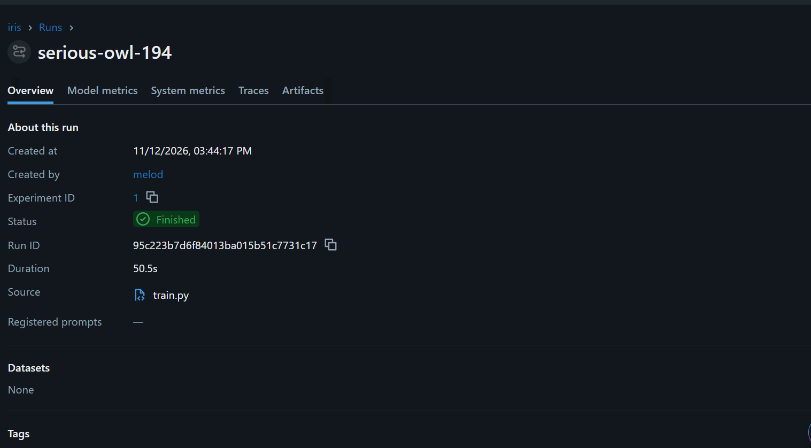
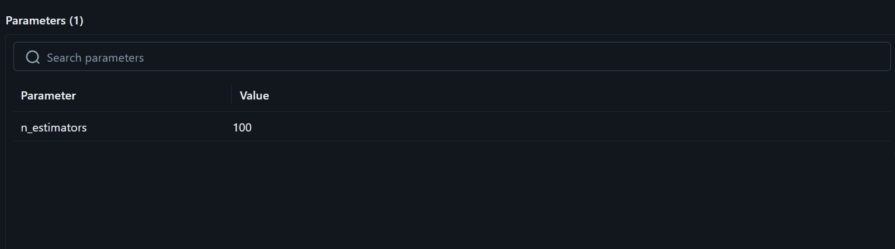
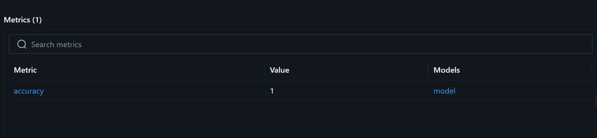
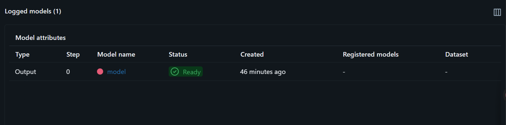
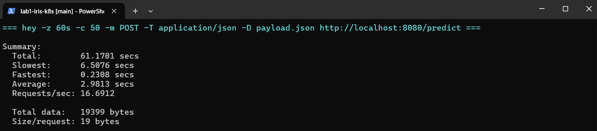
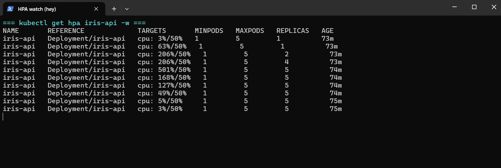
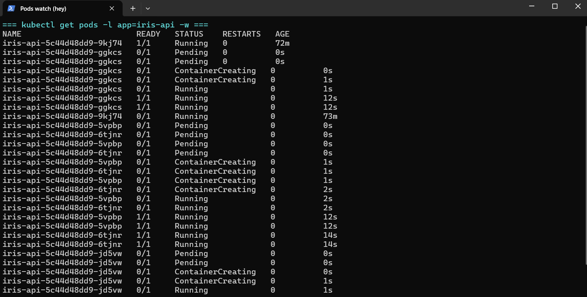

# Lab 1: Your First Model Service on Kubernetes

Train a scikit-learn Iris classifier, track it with MLflow, serve it with FastAPI,
deploy it to a local **kind** cluster, and autoscale it with an HPA.

```
train.py ──► MLflow (params · metrics · model)
   │
   ▼
model.pkl ──► app.py (FastAPI /predict) ──► docker image iris-api:v1
                                              │ kind load docker-image
                                              ▼
            kind cluster "mlops": Deployment iris-api (1→5 pods) ◄── HPA (cpu 50%) ◄── metrics-server
                                  Service iris-api  ClusterIP :80 → 8080
                                              ▲
                     curl / load test ── kubectl port-forward
```

## Files

| File | Purpose |
|---|---|
| `train.py` | Train RandomForest on Iris, log param/metric/model to MLflow, dump `model.pkl` |
| `app.py` | FastAPI predictor: `POST /predict`, `GET /healthz` |
| `Dockerfile` | Image `iris-api:v1` (scikit-learn pinned to the training version) |
| `deployment.yaml` | Deployment (requests 100m CPU, readinessProbe `/healthz`) + Service |
| `hpa.yaml` | HPA: cpu 50%, min 1, max 5 (same as `kubectl autoscale ...`) |
| `run-hey.ps1` + `payload.json` | Load test with `hey` (body read from file to avoid PowerShell quote-stripping) |
| `model.pkl` | Trained model, committed so the image can be built without re-training |
| `requirements.txt` | Python dependencies for training / MLflow |
| `.dockerignore` | Keeps `.venv`, MLflow data, etc. out of the Docker build context |
| `screenshots/` | MLflow run + HPA scaling evidence |

> `model.pkl` is included, so you can jump straight to Step 3 (`docker build`).
> It was produced by `train.py` with `random_state=42`, so re-running training yields the same model
> (`n_estimators=100`, `accuracy=1.0`) as the MLflow run in the screenshots.

## Steps (Windows PowerShell; Docker Desktop running)

```powershell
# Step 1 – cluster
kind create cluster --name mlops

# Step 2 – train + track
python -m venv .venv; .\.venv\Scripts\pip install -r requirements.txt
.\.venv\Scripts\python train.py          # accuracy=1.0000 -> model.pkl saved
.\.venv\Scripts\mlflow ui                # http://localhost:5000

# Step 3 – image
docker build -t iris-api:v1 .
kind load docker-image iris-api:v1 --name mlops

# Step 4 – deploy + test
kubectl apply -f deployment.yaml
kubectl get pods -w
kubectl port-forward svc/iris-api 8080:80     # in another terminal
curl.exe -X POST localhost:8080/predict -H "Content-Type: application/json" `
  -d '{\"instances\": [[5.1, 3.5, 1.4, 0.2]]}'
# {"predictions":[0]}

# Step 5 – autoscaling (metrics-server; kind needs --kubelet-insecure-tls)
kubectl apply -f https://github.com/kubernetes-sigs/metrics-server/releases/latest/download/components.yaml
kubectl -n kube-system patch deployment metrics-server --type=json `
  -p '[{\"op\":\"add\",\"path\":\"/spec/template/spec/containers/0/args/-\",\"value\":\"--kubelet-insecure-tls\"}]'
kubectl apply -f hpa.yaml
# hey for Windows: download hey_windows_amd64 and save it as bin\hey.exe
powershell -ExecutionPolicy Bypass -File .\run-hey.ps1   # = hey -z 60s -c 50 -m POST -T application/json -D payload.json http://localhost:8080/predictkubectl get hpa iris-api -w
```

## Results

- MLflow experiment `iris`: `n_estimators=100`, `accuracy=1.0`, model artifact logged.
- `/predict` on `[[5.1,3.5,1.4,0.2],[6.7,3.0,5.2,2.3]]` → `{"predictions":[0,2]}` (setosa, virginica).
- `hey` load test (60 s, 50 concurrent): 1021 requests, all `[200]`, ~16.7 req/s
  (see `screenshots/hey-output.txt`). HPA: cpu 3% → 63% → 206% → **501%** (capped by the
  500m limit = 5× the 100m request), replicas **1 → 2 → 4 → 5**, then back to 3% after the load stopped.
  HPA events: `New size: N; reason: cpu resource utilization (percentage of request) above target`.
  After the load ends, the HPA scales back to 1 pod once the default ~5-minute scale-down window passes.

## Screenshots

### MLflow run (`iris` / `serious-owl-194`)






### HPA scaling with `hey` (1 → 2 → 4 → 5 replicas under load)





## Notes / gotchas

- **MLflow 3.x + skops**: `log_model` now serializes sklearn with skops and refuses
  `sklearn.tree._tree.Tree` unless trusted — `train.py` passes
  `skops_trusted_types=["sklearn.tree._tree.Tree"]` (safe: we trained the model ourselves).
- **Pin scikit-learn in the image** to the version that produced `model.pkl`,
  otherwise unpickling can warn or break.
- **`kubectl port-forward svc/...` tunnels to a single pod**, so load is not spread across
  new replicas — that pod saturates and its readinessProbe can briefly fail. For real
  load-balancing, run the load generator inside the cluster against `http://iris-api/predict`.

## Cleanup

```powershell
kind delete cluster --name mlops
```
